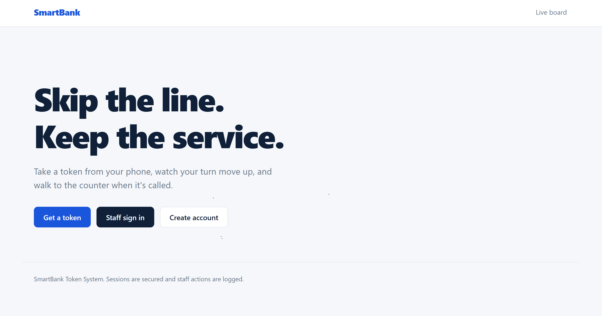
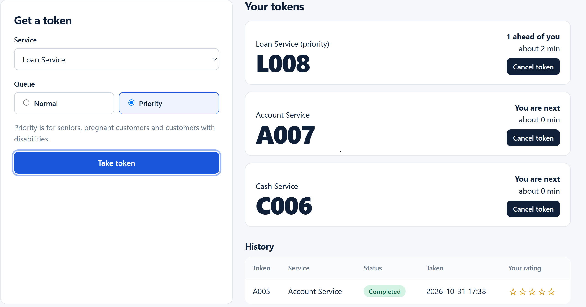
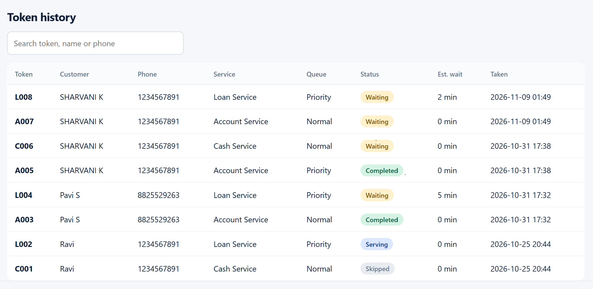
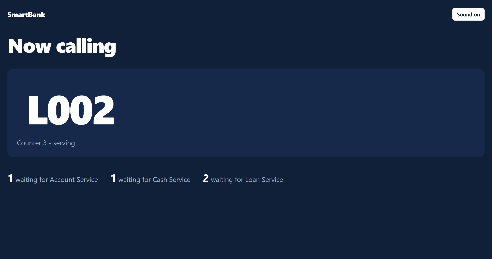

# 🏦 Smart Bank Token Management System

A computerized banking queue management system designed to simplify customer service, automate token generation, and improve queue management in banks.

## 📌 Project Overview

The **Smart Bank Token Management System** is a Java-based banking application that helps customers generate service tokens and allows bank staff to manage customer queues efficiently.

The system reduces manual queue handling, improves customer experience, and helps staff manage service counters through a centralized interface.

## 🎯 Objectives

- Automate the bank token generation process.
- Reduce customer waiting time.
- Organize customers based on their selected services.
- Improve counter allocation and queue management.
- Provide staff with an efficient queue monitoring interface.

## ✨ Key Features

### 1. Customer Registration
- Create a new customer account.
- Enter customer details.
- Store customer information in the database.

### 2. Token Generation
- Generate unique tokens for customers.
- Select banking services.
- Organize customers into appropriate queues.

### 3. Staff Login
- Secure staff authentication.
- Allow authorized staff to access queue management features.
- Manage customer service requests.

### 4. Live Queue Board
- Display current token information.
- Monitor customer queue status.
- Track counter availability and service progress.

### 5. Queue Management
- Manage customer waiting lists.
- Update token statuses.
- Support counter allocation and service processing.

## 🖥️ Project Screenshots

### 1. Homepage



### 2. Token Generation



### 3. Staff Login



### 4. Live Board



## 🛠️ Technologies Used

| Technology | Purpose |
|---|---|
| Java | Application development |
| MySQL | Database management |
| JDBC | Database connectivity |
| XAMPP | Local database server |
| NetBeans IDE | Java development |
| HTML, CSS, JavaScript | Web interface |

## 📂 Project Structure

```text
Smart-Bank-Server/
│
├── database/
│   └── SQL database files
│
├── nbproject/
│   └── NetBeans project configuration
│
├── screenshots/
│   ├── PIC-1.png
│   ├── PIC-2.png
│   ├── PIC-3.png
│   └── PIC-4.png
│
├── src/
│   └── Java source files
│
├── .gitignore
├── README.md
├── build.xml
└── manifest.mf
```

## ⚙️ Requirements

- Java Development Kit (JDK)
- NetBeans IDE
- XAMPP Server
- MySQL Database
- JDBC Driver
- Web Browser

## 🚀 Installation and Setup

1. Clone or download this repository.

2. Open the project in NetBeans IDE.

3. Start the MySQL service using XAMPP.

4. Create the required database in MySQL.

5. Import the SQL database file available in the `database` folder.

6. Configure the database connection and credentials in the application.

7. Build and run the project using the configured development environment.

8. Open the application in your browser if running through the local web server.

## 🔄 Application Workflow

1. Customer opens the banking application.
2. Customer registers or enters the required details.
3. Customer selects the required banking service.
4. System generates a unique token.
5. Customer waits for their token to be called.
6. Bank staff manages the queue through the staff interface.
7. Live board displays the current token and service progress.

## 🔮 Future Enhancements

- SMS and email notifications for token updates.
- AI-based queue prediction.
- Real-time waiting time estimation.
- Advanced analytics and reporting.
- Cloud-based deployment.
- Mobile application integration.

## 👩‍💻 Developer

**Pavatharini S**

B.E. Computer Science and Engineering (Cyber Security)

## 📄 License

This project is developed for educational and demonstration purposes.
